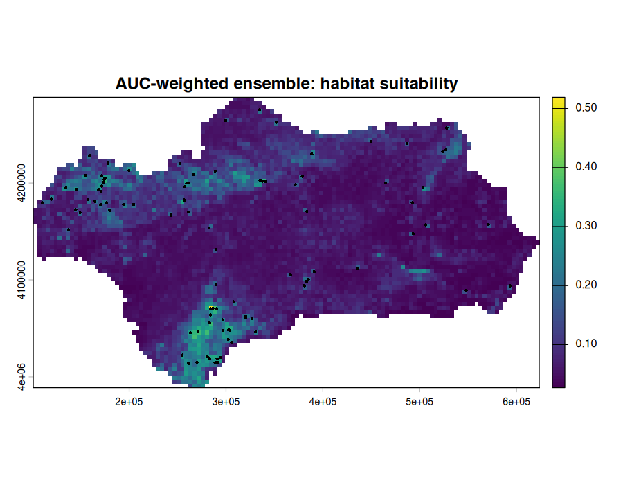
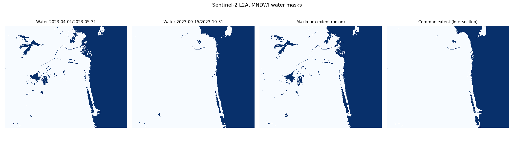

# Ensemble SDM and GeoAI workflow examples

Small, fully reproducible examples of two workflows I use in my work on geospatial machine
learning. Everything here runs on **public data only**.

| Folder | What it shows | Language |
|---|---|---|
| `R/` | Ensemble species-distribution / habitat-suitability modelling with the [`sdm`](https://CRAN.R-project.org/package=sdm) package: presence points + background points, collinearity screening, GLM / random forest / SVM, bootstrap and cross-validation replicates, TSS / AUC evaluation, variable importance, AUC-weighted ensemble, and **tile-wise prediction** of a raster so that very large rasters fit in memory. | R |
| `python/` | Water-extent mapping from open **Sentinel-2 L2A** data (Microsoft Planetary Computer STAC): cloud masking with the scene classification layer, MNDWI water index, and the **maximum (union)** and **common (intersection)** extent of two periods. | Python |

## Run the R example

```r
source("requirements.R")        # once
```
```bash
Rscript R/01_ensemble_sdm.R     # from the repository root
```
Outputs go to `outputs/`: `evaluation.csv` (AUC, TSS and COR per model replicate), `evaluation_by_method.csv`, `vif.csv`,
`variable_importance.png`, `ensemble_suitability.png`, `sessionInfo.txt`.

The example data are the occurrence points and four environmental rasters (elevation,
precipitation, temperature, vegetation) that ship with the `sdm` package. Only presences are
kept, and 1,000 background points are drawn, which is the presence-only set-up used for most
real applications.

## Run the Python example

```bash
python -m venv venv && source venv/bin/activate
pip install -r python/requirements.txt
python python/sentinel2_water_extent.py
```
No account or API key is needed. Change the area and the two date windows with `--bbox`,
`--period-a` and `--period-b`. Outputs: `outputs/water_extent.png` and
`outputs/water_extent_stats.csv`.

## Example results (from the last run)

**R, ensemble SDM** (`sdm` example data, presence-only + 1,000 background points):

* VIF screening removed `temperature` (VIF ≈ 32, collinear with elevation); kept elevation, precipitation, vegetation.
* Mean test performance per algorithm (bootstrap + 5-fold CV):

  | method | AUC | TSS |
  |---|---|---|
  | GLM | 0.73 | 0.44 |
  | Random forest | 0.64 | 0.29 |
  | SVM | 0.55 | 0.21 |

  These values only illustrate the workflow on a small demonstration dataset; the AUC weighting
  automatically gives the weaker models less influence in the ensemble.
* Tile-wise prediction reproduces the direct ensemble exactly (correlation = 1).



**Python, Sentinel-2 MNDWI** (default area: southern shore of Lake Urmia, Iran; spring vs autumn 2023,
8 clearest scenes per period):

| metric | km² |
|---|---|
| water, Apr–May 2023 | 50.1 |
| water, mid-Sep–Oct 2023 | 45.8 |
| maximum extent (union) | 51.1 |
| common extent (intersection) | 44.8 |

The difference is mostly seasonal wetlands and ponds west of the lake that are flooded in spring and dry by autumn.



## Notes

* These scripts are generic re-implementations written for this repository. They contain no
  client data, maps or confidential material.
* Method reference for the modelling package: Naimi, B. & Araújo, M. B. (2016). sdm: a reproducible
  and extensible R platform for species distribution modelling. *Ecography*, 39, 368–375.
* Sentinel-2 data: Copernicus Sentinel data, accessed through the Microsoft Planetary Computer.

## Author

Mitra Naeimi, PhD (Remote Sensing and GIS) · ORCID [0009-0003-3341-2263](https://orcid.org/0009-0003-3341-2263)
· [LinkedIn](https://www.linkedin.com/in/mnaeimi)

Licence: MIT.
